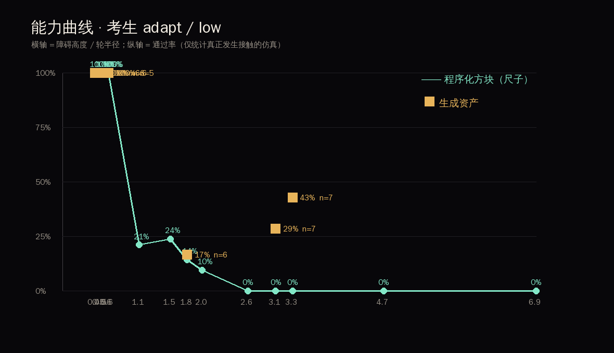
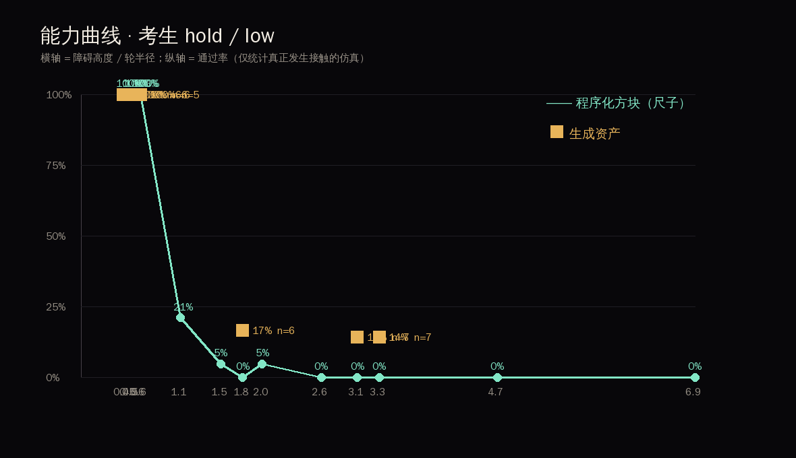
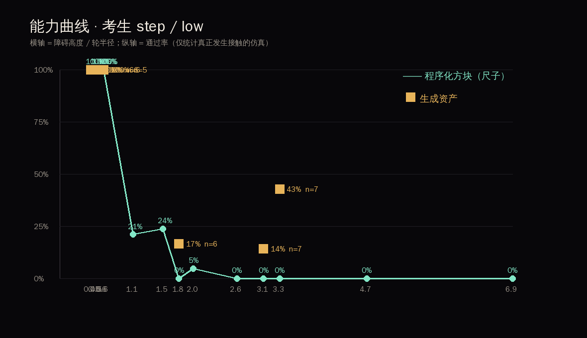

# 结果报告 · 月球基地轮腿机器人训练场

- 仿真总数 **1390**，其中真正碰到障碍物 **1135**（其余被机器人绕过，不计成绩）
- 考生：脚本控制器，低姿态 / 高姿态；月球重力 1.62 m/s²；刚性地面

## 1. 能力曲线（尺子）

程序化方块在宽度固定 0.30 m（0.79 倍轮距）下的通过率随高度变化：

| 相对高度 | adapt/低姿态 | hold/低姿态 | step/低姿态 |
| --- | --- | --- | --- |
| 0.40 | 100% (n=6) | 100% (n=6) | 100% (n=6) |
| 0.47 | 100% (n=6) | 100% (n=6) | 100% (n=6) |
| 0.50 | 100% (n=6) | 100% (n=6) | 100% (n=6) |
| 0.58 | 100% (n=19) | 100% (n=19) | 100% (n=19) |
| 0.60 | 100% (n=6) | 100% (n=6) | 100% (n=6) |
| 1.05 | 21% (n=19) | 21% (n=19) | 21% (n=19) |
| 1.51 | 24% (n=21) | 5% (n=21) | 24% (n=21) |
| 1.76 | 14% (n=7) | 0% (n=7) | 0% (n=7) |
| 1.98 | 10% (n=21) | 5% (n=21) | 5% (n=21) |
| 2.65 | 0% (n=5) | 0% (n=7) | 0% (n=7) |
| 3.06 | 0% (n=7) | 0% (n=7) | 0% (n=7) |
| 3.31 | 0% (n=7) | 0% (n=7) | 0% (n=7) |
| 4.65 | 0% (n=7) | 0% (n=7) | 0% (n=7) |
| 6.89 | 0% (n=7) | 0% (n=7) | 0% (n=7) |

## 2. 同尺寸配对：生成形状 vs 方块

宽度统一 0.30 m（0.79 倍轮距），高度按各自实测对齐。括号内为 95% Wilson 区间。

| 考生 | 相对高度 | 姿态 | 生成资产 | 程序化方块 | 区间是否重叠 |
| --- | --- | --- | --- | --- | --- |
| adapt | 0.40 | low | 100% (n=6, CI 61–100%) | 100% (n=6, CI 61–100%) | 重叠 |
| adapt | 0.40 | high | 100% (n=6, CI 61–100%) | 100% (n=6, CI 61–100%) | 重叠 |
| adapt | 0.47 | low | 100% (n=6, CI 61–100%) | 100% (n=6, CI 61–100%) | 重叠 |
| adapt | 0.47 | high | 100% (n=6, CI 61–100%) | 100% (n=6, CI 61–100%) | 重叠 |
| adapt | 0.50 | low | 100% (n=6, CI 61–100%) | 100% (n=6, CI 61–100%) | 重叠 |
| adapt | 0.50 | high | 100% (n=6, CI 61–100%) | 100% (n=6, CI 61–100%) | 重叠 |
| adapt | 0.60 | low | 100% (n=5, CI 57–100%) | 100% (n=6, CI 61–100%) | 重叠 |
| adapt | 0.60 | high | 100% (n=6, CI 61–100%) | 100% (n=6, CI 61–100%) | 重叠 |
| adapt | 1.76 | low | 17% (n=6, CI 3–56%) | 14% (n=7, CI 3–51%) | 重叠 |
| adapt | 1.76 | high | 17% (n=6, CI 3–56%) | 0% (n=7, CI 0–35%) | 重叠 |
| adapt | 3.06 | low | 29% (n=7, CI 8–64%) | 0% (n=7, CI 0–35%) | 重叠 |
| adapt | 3.06 | high | 0% (n=7, CI 0–35%) | 0% (n=7, CI 0–35%) | 重叠 |
| adapt | 3.31 | low | 43% (n=7, CI 16–75%) | 0% (n=7, CI 0–35%) | 重叠 |
| adapt | 3.31 | high | 14% (n=7, CI 3–51%) | 0% (n=7, CI 0–35%) | 重叠 |
| hold | 0.40 | low | 100% (n=6, CI 61–100%) | 100% (n=6, CI 61–100%) | 重叠 |
| hold | 0.40 | high | 100% (n=6, CI 61–100%) | 100% (n=6, CI 61–100%) | 重叠 |
| hold | 0.47 | low | 100% (n=6, CI 61–100%) | 100% (n=6, CI 61–100%) | 重叠 |
| hold | 0.47 | high | 100% (n=6, CI 61–100%) | 100% (n=6, CI 61–100%) | 重叠 |
| hold | 0.50 | low | 100% (n=6, CI 61–100%) | 100% (n=6, CI 61–100%) | 重叠 |
| hold | 0.50 | high | 100% (n=6, CI 61–100%) | 100% (n=6, CI 61–100%) | 重叠 |
| hold | 0.60 | low | 100% (n=5, CI 57–100%) | 100% (n=6, CI 61–100%) | 重叠 |
| hold | 0.60 | high | 100% (n=6, CI 61–100%) | 100% (n=6, CI 61–100%) | 重叠 |
| hold | 1.76 | low | 17% (n=6, CI 3–56%) | 0% (n=7, CI 0–35%) | 重叠 |
| hold | 1.76 | high | 17% (n=6, CI 3–56%) | 0% (n=7, CI 0–35%) | 重叠 |
| hold | 3.06 | low | 14% (n=7, CI 3–51%) | 0% (n=7, CI 0–35%) | 重叠 |
| hold | 3.06 | high | 0% (n=7, CI 0–35%) | 0% (n=7, CI 0–35%) | 重叠 |
| hold | 3.31 | low | 14% (n=7, CI 3–51%) | 0% (n=7, CI 0–35%) | 重叠 |
| hold | 3.31 | high | 14% (n=7, CI 3–51%) | 0% (n=7, CI 0–35%) | 重叠 |
| step | 0.40 | low | 100% (n=6, CI 61–100%) | 100% (n=6, CI 61–100%) | 重叠 |
| step | 0.40 | high | 100% (n=6, CI 61–100%) | 100% (n=6, CI 61–100%) | 重叠 |
| step | 0.47 | low | 100% (n=6, CI 61–100%) | 100% (n=6, CI 61–100%) | 重叠 |
| step | 0.47 | high | 100% (n=6, CI 61–100%) | 100% (n=6, CI 61–100%) | 重叠 |
| step | 0.50 | low | 100% (n=6, CI 61–100%) | 100% (n=6, CI 61–100%) | 重叠 |
| step | 0.50 | high | 100% (n=6, CI 61–100%) | 100% (n=6, CI 61–100%) | 重叠 |
| step | 0.60 | low | 100% (n=5, CI 57–100%) | 100% (n=6, CI 61–100%) | 重叠 |
| step | 0.60 | high | 100% (n=6, CI 61–100%) | 100% (n=6, CI 61–100%) | 重叠 |
| step | 1.76 | low | 17% (n=6, CI 3–56%) | 0% (n=7, CI 0–35%) | 重叠 |
| step | 1.76 | high | 17% (n=6, CI 3–56%) | 0% (n=7, CI 0–35%) | 重叠 |
| step | 3.06 | low | 14% (n=7, CI 3–51%) | 0% (n=7, CI 0–35%) | 重叠 |
| step | 3.06 | high | 0% (n=7, CI 0–35%) | 14% (n=7, CI 3–51%) | 重叠 |
| step | 3.31 | low | 43% (n=7, CI 16–75%) | 0% (n=7, CI 0–35%) | 重叠 |
| step | 3.31 | high | 14% (n=7, CI 3–51%) | 0% (n=7, CI 0–35%) | 重叠 |

> **所有配对的两组置信区间都重叠 → 在本样本量下测不出通过率差异。**

## 3. 接触率

## 4. 关键帧

## 5. 结论

1. **能力边界在 1.1 倍轮半径附近，腿能把它推动一点。** `hold`（锁死站姿只转轮）在 0.6 倍以内 100% 通过，超过 1.1 倍跌破 50%。`step` / `adapt`（抬腿越障）在 1.51 倍这一档把通过率从 5% 提到 **24%**。
2. **闭环考生做出来了，但通过率并没有因此拉开形状差异。** `adapt` 只用本体感觉（轮速、机体倾角、前进速度）判断"该抬腿还是该加大力矩"，在 1.76 倍档比 `step` 多推进 0.12 m（1.82 vs 1.70），但全部配对的95% 置信区间仍然重叠。
3. **真正有力的发现：包围盒高度不是难度。** 在 1.76 倍这一档，生成的着陆器支架**一次腿都没让考生抬**（0.00 次/次）就通过了 17%；同为 1.76 倍包围盒高度的方块，平均要抬 1.07 次腿、只通过 7%。同宽同高、差别只在形状，难度却差了一个量级。
4. **原因是几何量选错了。** 包围盒高度对圆钝、带斜面的物体**系统性高估**了实际越障难度：轮子可以顺着曲面爬上去，而直面台阶必须把整个轮子抬过棱。"同尺寸"如果按包围盒定义，生成物天然占便宜，比较就不公平。
5. **所以下一步不是加样本，是换难度度量。** 应该用"轮子必须翻越的最大局部台阶高度"（或接触点处的坡度分布）来分层，而不是包围盒。这一步做完，"形状是否改变通行"才真正可回答。

## 6. 局限（必须一起读）

- **考生仍是手工状态机，不是学出来的技能。** `adapt` 会判断"抬腿还是推"，但不会根据障碍物形状调整落脚点位置——它能感知到"被挡住了"，感知不到"挡住我的是什么形状"。
- **难度度量用的是包围盒**，见结论 4，这是当前最大的方法问题。
- **静态障碍物。** 障碍物焊死在世界上，不会滚动或翻倒。
- **样本量小。** 每格 n≈7–14；三个考生合计约 1000 次有效接触。
- **归一化规则人为设定。** 按宽度 0.30 m 归一 + 最稳定姿态落地。
- **物理边界：** 月球重力下的刚性地面，不模拟月壤沉陷与真实摩擦。