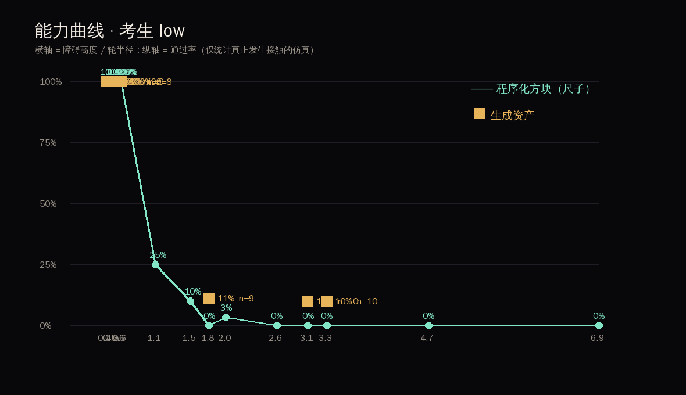
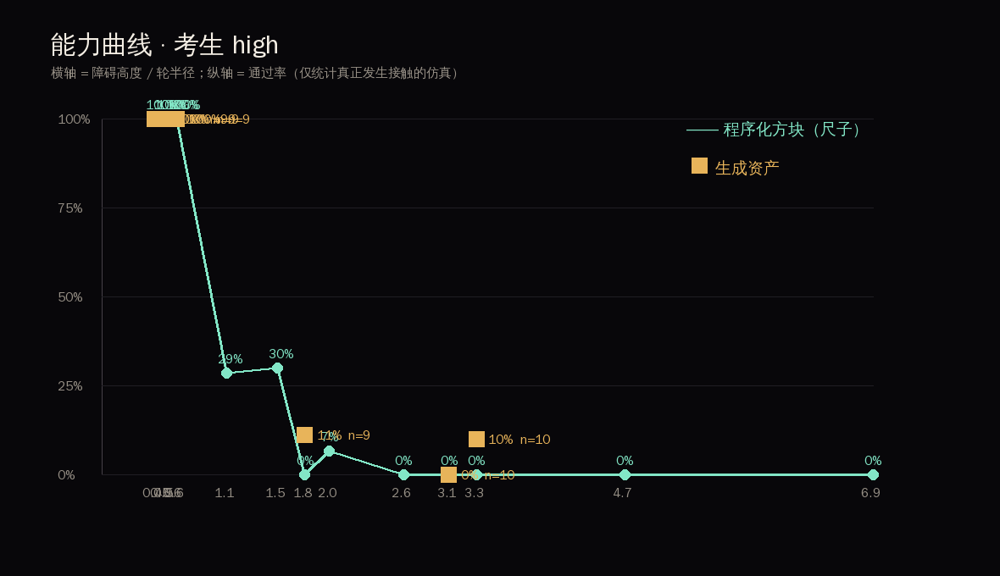
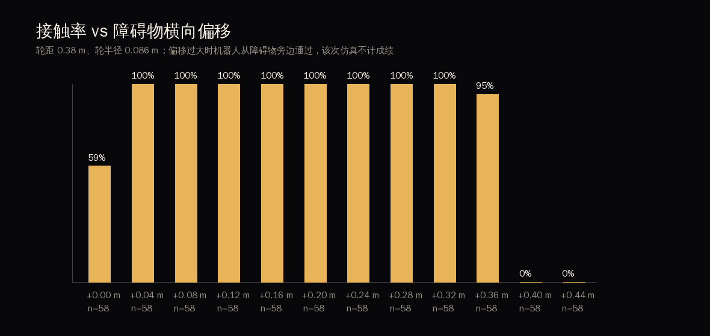
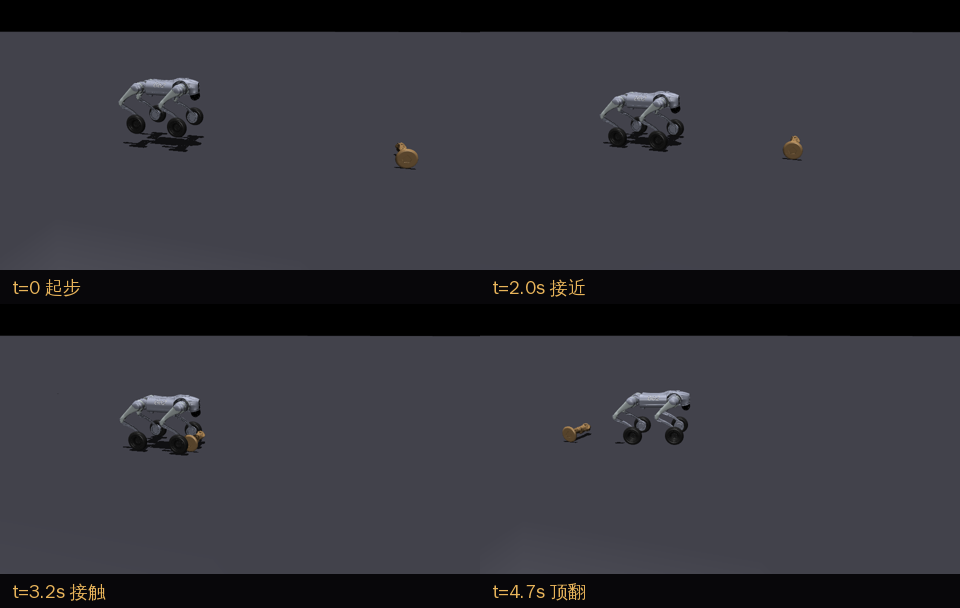

# 结果报告 · 月球基地轮腿机器人训练场

- 仿真总数 **696**，其中真正碰到障碍物 **553**（其余被机器人绕过，不计成绩）
- 考生：脚本控制器，低姿态 / 高姿态；月球重力 1.62 m/s²；刚性地面

## 1. 能力曲线（尺子）

程序化方块在宽度固定 0.30 m（0.79 倍轮距）下的通过率随高度变化：

| 相对高度 | 低姿态 | 高姿态 |
| --- | --- | --- |
| 0.40 | 100% (n=9) | 100% (n=9) |
| 0.47 | 100% (n=9) | 100% (n=9) |
| 0.50 | 100% (n=9) | 100% (n=9) |
| 0.58 | 100% (n=28) | 100% (n=28) |
| 0.60 | 100% (n=9) | 100% (n=9) |
| 1.05 | 25% (n=28) | 29% (n=28) |
| 1.51 | 10% (n=30) | 30% (n=30) |
| 1.76 | 0% (n=10) | 0% (n=10) |
| 1.98 | 3% (n=30) | 7% (n=30) |
| 2.65 | 0% (n=10) | 0% (n=10) |
| 3.06 | 0% (n=10) | 0% (n=10) |
| 3.31 | 0% (n=10) | 0% (n=10) |
| 4.65 | 0% (n=10) | 0% (n=10) |
| 6.89 | 0% (n=10) | 0% (n=10) |

## 2. 同尺寸配对：生成形状 vs 方块

宽度统一 0.30 m（0.79 倍轮距），高度按各自实测对齐。括号内为 95% Wilson 区间。

| 相对高度 | 考生 | 生成资产 | 程序化方块 | 区间是否重叠 |
| --- | --- | --- | --- | --- |
| 0.40 | low | 100% (n=9, CI 70–100%) | 100% (n=9, CI 70–100%) | 重叠 |
| 0.40 | high | 100% (n=9, CI 70–100%) | 100% (n=9, CI 70–100%) | 重叠 |
| 0.47 | low | 100% (n=9, CI 70–100%) | 100% (n=9, CI 70–100%) | 重叠 |
| 0.47 | high | 100% (n=9, CI 70–100%) | 100% (n=9, CI 70–100%) | 重叠 |
| 0.50 | low | 100% (n=9, CI 70–100%) | 100% (n=9, CI 70–100%) | 重叠 |
| 0.50 | high | 100% (n=9, CI 70–100%) | 100% (n=9, CI 70–100%) | 重叠 |
| 0.60 | low | 100% (n=8, CI 68–100%) | 100% (n=9, CI 70–100%) | 重叠 |
| 0.60 | high | 100% (n=9, CI 70–100%) | 100% (n=9, CI 70–100%) | 重叠 |
| 1.76 | low | 11% (n=9, CI 2–44%) | 0% (n=10, CI 0–28%) | 重叠 |
| 1.76 | high | 11% (n=9, CI 2–44%) | 0% (n=10, CI 0–28%) | 重叠 |
| 3.06 | low | 10% (n=10, CI 2–40%) | 0% (n=10, CI 0–28%) | 重叠 |
| 3.06 | high | 0% (n=10, CI 0–28%) | 0% (n=10, CI 0–28%) | 重叠 |
| 3.31 | low | 10% (n=10, CI 2–40%) | 0% (n=10, CI 0–28%) | 重叠 |
| 3.31 | high | 10% (n=10, CI 2–40%) | 0% (n=10, CI 0–28%) | 重叠 |

> **所有配对的两组置信区间都重叠 → 在本样本量下测不出通过率差异。**

## 3. 接触率

## 4. 关键帧

## 5. 结论

1. **能力边界在 1.1 倍轮半径附近。** 低姿态下，方块高度低于约 0.6 倍轮半径时通过率 100%；超过 1.1 倍后跌破 50%。这条曲线就是后续一切比较的尺子。
2. **同尺寸下测不出生成形状与简单方块的差异。** 宽度统一到 0.30 m（0.79 倍轮距）、高度按实测对齐后，全部 7 组配对的两组 95% 置信区间都重叠。也就是说：在本样本量与当前考生下，**形状细节没有改变通行结果**。
3. **倾向性（不构成结论）：** 在边界带（1.76–3.31 倍轮半径），生成资产出现 10–11% 的通过，而方块为 0%。方向与直觉相反——圆钝、带斜面的生成物体比直面方块更容易被轮子爬上去。这意味着"只用简单方块出题"是**偏严**的，不是漏测。但 n≈10、区间重叠，只能作为下一轮加大样本的假设。

## 6. 局限（必须一起读）

- **考生没有用腿。** 两个脚本控制器都只是保持固定站姿 + 轮速伺服，本质是四轮小车。轮腿的腿自由度完全没有参与越障，所以"凹槽、悬空、可踩踏的凸台"这些形状细节自然无法体现价值。这是当前结论最大的局限，也是下一阶段最该补的。
- **静态障碍物。** 障碍物焊死在世界上，不会滚动或翻倒；真实残骸会动。计划要求的"自由放置 2 秒几乎不动"的静置检查还没做。
- **样本量小。** 每格 n≈10；生成资产有效接触 129 次、程序化 424 次（共 553）。不足以支撑"形状无影响"这个强结论，只能说"没测出"。
- **尺度与朝向是人为定义的。** 按宽度 0.30 m 归一、按最稳定姿态落地，这两条规则直接影响分层归属；换一种归一方式，结论可能变化。
- **物理边界：** 月球重力下的刚性地面，不模拟月壤沉陷与真实摩擦。