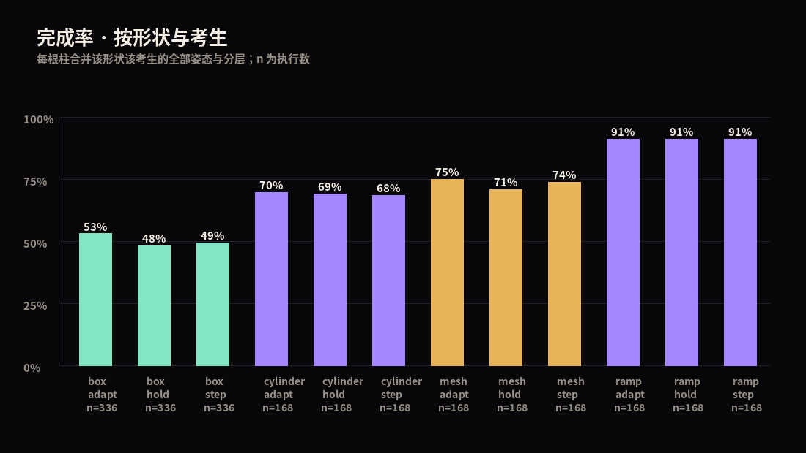

# 运行报告

- 运行目录：`canonical_r2`　suite：`canonical`
- 输入：`results.jsonl`（记录 2520 条，非法行 0）
- 运行源码内容哈希：`05fd8807772027bb6149f1b6be8532fa`（git cb018a0662aeb73eb23ba6843460551968f22203，未提交修改 False）
- 模型：`c8feaef4afdf360335727c80a826d161`（git 1eb6642e3f3fdfb7fb13a9794fd6a2dd93ea0e7d，未提交修改 False）
- 版本：`{'mujoco': '3.17.0', 'numpy': '2.5.4', 'trimesh': '5.2.0', 'coacd': '1.0.14', 'manifold3d': '3.5.4', 'pillow': '13.0.0'}`

## 1. 任务计数

| 计划 | 收到 | ok | 预检失败 | ERROR | 缺失 | 重复 | 非法行 |
| --- | --- | --- | --- | --- | --- | --- | --- |
| 2520 | 2520 | 2520 | 0 | 0 | 0 | 0 | 0 |

已执行记录的结果分布：`{'stuck': 78, 'tipped': 754, 'completed': 1682, 'timeout': 6}`

其中「完成」是**终点任务完成数**（机体中心越过障碍后方净空），包含未接触障碍物的场景，不等于"越障成功数"。

接触覆盖：任意机体接触 2007　轮子接触 1951　未接触 513（分母 = 已执行 2520）。

## 2. 分形状 × 分考生

| shape | 来源 | 考生 | 姿态 | 执行 | 接触(任意) | 接触(轮) | 完成 | 完成率 | 结果分布 |
| --- | --- | --- | --- | --- | --- | --- | --- | --- | --- |
| box | procedural | adapt | high | 168 | 134 | 133 | 94 | 56% | {'completed': 94, 'tipped': 73, 'timeout': 1} |
| box | procedural | adapt | low | 168 | 134 | 129 | 84 | 50% | {'completed': 84, 'tipped': 79, 'timeout': 4, 'stuck': 1} |
| box | procedural | hold | high | 168 | 134 | 129 | 82 | 49% | {'completed': 82, 'tipped': 86} |
| box | procedural | hold | low | 168 | 134 | 118 | 80 | 48% | {'completed': 80, 'tipped': 69, 'stuck': 19} |
| box | procedural | step | high | 168 | 134 | 128 | 85 | 51% | {'completed': 85, 'tipped': 83} |
| box | procedural | step | low | 168 | 134 | 129 | 81 | 48% | {'completed': 81, 'tipped': 86, 'stuck': 1} |
| cylinder | procedural | adapt | high | 84 | 66 | 63 | 58 | 69% | {'completed': 58, 'tipped': 17, 'stuck': 9} |
| cylinder | procedural | adapt | low | 84 | 66 | 63 | 59 | 70% | {'completed': 59, 'tipped': 21, 'stuck': 4} |
| cylinder | procedural | hold | high | 84 | 66 | 63 | 59 | 70% | {'completed': 59, 'stuck': 15, 'tipped': 10} |
| cylinder | procedural | hold | low | 84 | 66 | 63 | 57 | 68% | {'completed': 57, 'stuck': 12, 'tipped': 15} |
| cylinder | procedural | step | high | 84 | 66 | 64 | 57 | 68% | {'completed': 57, 'tipped': 25, 'stuck': 2} |
| cylinder | procedural | step | low | 84 | 66 | 64 | 58 | 69% | {'completed': 58, 'tipped': 20, 'stuck': 6} |
| mesh | lux3d | adapt | high | 84 | 65 | 65 | 62 | 74% | {'tipped': 21, 'completed': 62, 'timeout': 1} |
| mesh | lux3d | adapt | low | 84 | 64 | 64 | 64 | 76% | {'completed': 64, 'tipped': 20} |
| mesh | lux3d | hold | high | 84 | 65 | 65 | 60 | 71% | {'tipped': 24, 'completed': 60} |
| mesh | lux3d | hold | low | 84 | 64 | 62 | 59 | 70% | {'stuck': 6, 'tipped': 19, 'completed': 59} |
| mesh | lux3d | step | high | 84 | 65 | 65 | 63 | 75% | {'tipped': 21, 'completed': 63} |
| mesh | lux3d | step | low | 84 | 64 | 64 | 61 | 73% | {'tipped': 23, 'completed': 61} |
| ramp | procedural | adapt | high | 84 | 70 | 70 | 72 | 86% | {'completed': 72, 'tipped': 12} |
| ramp | procedural | adapt | low | 84 | 70 | 70 | 81 | 96% | {'completed': 81, 'tipped': 3} |
| ramp | procedural | hold | high | 84 | 70 | 70 | 72 | 86% | {'completed': 72, 'tipped': 12} |
| ramp | procedural | hold | low | 84 | 70 | 70 | 81 | 96% | {'completed': 81, 'stuck': 3} |
| ramp | procedural | step | high | 84 | 70 | 70 | 72 | 86% | {'completed': 72, 'tipped': 12} |
| ramp | procedural | step | low | 84 | 70 | 70 | 81 | 96% | {'completed': 81, 'tipped': 3} |

## 3. 同尺寸对照（box vs 生成网格）

匹配的是**相对高度与横向宽度**，前后长度未必相同；偏移网格与控制配置在同一批次内一致。格式为「完成数/执行数」。

| 相对高度 | 考生 | 姿态 | box | mesh |
| --- | --- | --- | --- | --- |
| 0.40 | adapt | high | 12/12 | 12/12 |
| 0.40 | adapt | low | 12/12 | 12/12 |
| 0.40 | hold | high | 12/12 | 12/12 |
| 0.40 | hold | low | 12/12 | 12/12 |
| 0.40 | step | high | 12/12 | 12/12 |
| 0.40 | step | low | 12/12 | 12/12 |
| 0.47 | adapt | high | 12/12 | 12/12 |
| 0.47 | adapt | low | 12/12 | 12/12 |
| 0.47 | hold | high | 12/12 | 12/12 |
| 0.47 | hold | low | 12/12 | 12/12 |
| 0.47 | step | high | 12/12 | 12/12 |
| 0.47 | step | low | 12/12 | 12/12 |
| 0.50 | adapt | high | 12/12 | 12/12 |
| 0.50 | adapt | low | 12/12 | 12/12 |
| 0.50 | hold | high | 12/12 | 12/12 |
| 0.50 | hold | low | 12/12 | 12/12 |
| 0.50 | step | high | 12/12 | 12/12 |
| 0.50 | step | low | 12/12 | 12/12 |
| 0.60 | adapt | high | 12/12 | 12/12 |
| 0.60 | adapt | low | 12/12 | 12/12 |
| 0.60 | hold | high | 12/12 | 12/12 |
| 0.60 | hold | low | 12/12 | 12/12 |
| 0.60 | step | high | 12/12 | 12/12 |
| 0.60 | step | low | 12/12 | 12/12 |
| 1.76 | adapt | high | 5/12 | 7/12 |
| 1.76 | adapt | low | 3/12 | 5/12 |
| 1.76 | hold | high | 2/12 | 7/12 |
| 1.76 | hold | low | 2/12 | 5/12 |
| 1.76 | step | high | 2/12 | 7/12 |
| 1.76 | step | low | 2/12 | 5/12 |
| 3.06 | adapt | high | 3/12 | 3/12 |
| 3.06 | adapt | low | 2/12 | 4/12 |
| 3.06 | hold | high | 2/12 | 2/12 |
| 3.06 | hold | low | 2/12 | 3/12 |
| 3.06 | step | high | 3/12 | 3/12 |
| 3.06 | step | low | 2/12 | 3/12 |
| 3.31 | adapt | high | 3/12 | 4/12 |
| 3.31 | adapt | low | 3/12 | 7/12 |
| 3.31 | hold | high | 2/12 | 3/12 |
| 3.31 | hold | low | 2/12 | 3/12 |
| 3.31 | step | high | 2/12 | 5/12 |
| 3.31 | step | low | 2/12 | 5/12 |

共 42 条，来自少量几何对在不同考生与站姿下的重复比较，**不是**独立形状样本，不作显著性推断。

## 4. 怎么读这张表

- 完成率分母是**已执行 trial**，含未接触障碍物的场景；「接触后完成率」需另取分母，不同控制器接触子集不同，不能称严格配对。
- 横向偏移是确定性网格，非随机采样；结果只描述这张网格。
- 同一资产的多个偏移不是独立形状家族。
- 三个考生是手工控制器，不能读作"学会了越障"。
- 障碍物静态刚性，地面刚性，摩擦未标定。

## 5. 未做的事

- 未做形状家族留出 → 不能声称泛化。
- 未做训练对照 → 不能声称对训练有帮助。
- 未独立定义"有效难度" → 不能声称"同难度下无差异"。