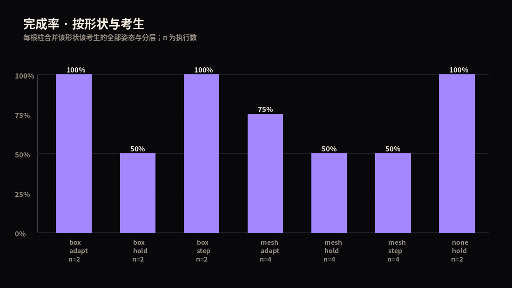

# 运行报告

- 运行目录：`smoke_test`　suite：`smoke`
- 输入：`results.jsonl`（记录 20 条，无法解析 0 行）
- 代码提交：`e85813806912`（未提交修改：True）
- 模型提交：`1eb6642e3f3f`
- 版本：`{'mujoco': '3.17.0', 'numpy': '2.5.4', 'trimesh': '5.2.0', 'coacd': 'unknown', 'manifold3d': 'unknown'}`

## 1. 任务计数

| 计划 | 执行 | 预检失败 | 未接触 | 接触(任意机体) | 接触(轮子) |
| --- | --- | --- | --- | --- | --- |
| 20 | 20 | 0 | 2 | 18 | 11 |

结果分布（分母 = 已执行 20）：`{'completed': 14, 'tipped': 6}`

## 2. 分形状 × 分考生

方块、圆柱、斜坡、生成网格分别统计；三个考生分别统计，不合并成单一比例。

| shape | 来源 | 考生 | 姿态 | 执行 | 接触(任意) | 接触(轮) | 完成 | 完成率 | 结果分布 |
| --- | --- | --- | --- | --- | --- | --- | --- | --- | --- |
| box | procedural | adapt | high | 1 | 1 | 0 | 1 | 100% | {'completed': 1} |
| box | procedural | adapt | low | 1 | 1 | 0 | 1 | 100% | {'completed': 1} |
| box | procedural | hold | high | 1 | 1 | 0 | 1 | 100% | {'completed': 1} |
| box | procedural | hold | low | 1 | 1 | 0 | 0 | 0% | {'tipped': 1} |
| box | procedural | step | high | 1 | 1 | 0 | 1 | 100% | {'completed': 1} |
| box | procedural | step | low | 1 | 1 | 0 | 1 | 100% | {'completed': 1} |
| mesh | lux3d | adapt | high | 2 | 2 | 2 | 1 | 50% | {'tipped': 1, 'completed': 1} |
| mesh | lux3d | adapt | low | 2 | 2 | 2 | 2 | 100% | {'completed': 2} |
| mesh | lux3d | hold | high | 2 | 2 | 2 | 1 | 50% | {'tipped': 1, 'completed': 1} |
| mesh | lux3d | hold | low | 2 | 2 | 1 | 1 | 50% | {'tipped': 1, 'completed': 1} |
| mesh | lux3d | step | high | 2 | 2 | 2 | 1 | 50% | {'tipped': 1, 'completed': 1} |
| mesh | lux3d | step | low | 2 | 2 | 2 | 1 | 50% | {'tipped': 1, 'completed': 1} |
| none | none | hold | high | 1 | 0 | 0 | 1 | 100% | {'completed': 1} |
| none | none | hold | low | 1 | 0 | 0 | 1 | 100% | {'completed': 1} |

## 3. 同尺寸对照（box vs 生成网格）

本次输入中没有任何同高度的 box 与 mesh 配对，**因此不对形状差异作任何陈述**。

## 4. 怎么读这张表

- 完成率的分母是**已执行 trial**，其中包含未接触障碍物的场景；"接触后完成率"需要另取分母，本文未做该条件统计。
- 横向偏移是**确定性网格**，不是随机采样；本表的完成率只描述这张网格，不能外推为随机月面或现实任务的成功概率。
- 同一资产的多个偏移不是多个独立的形状家族。
- 三个考生是手工控制器：`hold` 锁死站姿只转轮，`step` 执行固定抬腿序列，`adapt` 用本体感觉在"抬腿/加大力矩"之间二选一。都不能读作"学会了越障"。
- 障碍物是**静态刚性体**，不滚动、不翻倒；地面刚性，摩擦未标定。

## 5. 未做的事

- 未做形状家族留出测试，**不能**声称"对未见过物体泛化"。
- 未做训练对照，**不能**声称生成资产对训练有帮助。
- 未独立定义"有效难度"，**不能**声称"同难度下无差异"。